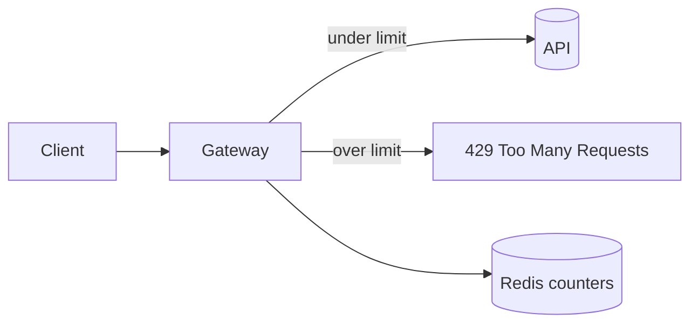

# Add rate limiting to the API

We are adding per-token rate limiting to the public API to protect upstream
services from bursty clients. The goal is a sliding-window limiter enforced at
the edge, observable, and safe to roll out behind a flag.

<Callout type='decision'>
  Limits are enforced in the gateway, not per-service, so a single client can't
  starve the fleet by spreading requests across endpoints.
</Callout>

<Stat>
- Files changed: 4
- Added latency: ~1 ms (good)
- Rollout: 1% to 100% (warn) -- ramp while watching reject rates
</Stat>

## Architecture



## Approach

<Compare>
## Redis sliding window (pick)
- pro: accurate
- pro: shared across nodes
- con: network hop

## In-memory token bucket
- pro: fast
- pro: no deps
- con: per-node only
- con: lost on restart
</Compare>

<Matrix>
| Criterion           | Redis window (pick) | In-memory bucket |
|---------------------|---------------------|------------------|
| Accuracy            | exact               | approximate      |
| Shared across nodes | yes                 | no               |
| Added latency       | ~1ms                | none             |
| Ops burden          | a Redis dependency  | none             |
</Matrix>

<Questions>
- What is the limit per token: a fixed number, or per-plan tier?
- Should the limiter fail open or fail closed if Redis is unreachable?
  - Fail open, availability first
  - Fail closed, safety first
- Do internal service-to-service calls get exempted from limiting?
</Questions>

<Phase title='Build the limiter' status='active'>
  1. Add a `RateLimiter` backed by Redis `INCR` + `EXPIRE`.
  2. Return `429` with a `Retry-After` header when the window is exceeded.

  <FileTree>
  - add src/gateway/rate-limiter.ts -- sliding-window check against Redis
  - modify src/gateway/middleware.ts -- mount the limiter behind the flag
  - move src/gateway/throttle.ts -> src/gateway/rate-limiter-legacy.ts
  - delete src/gateway/legacy/
  </FileTree>

  ```ts title="src/gateway/rate-limiter.ts"
  // sliding-window check against Redis, returns false when over the limit
  async function allow(token: string): Promise<boolean> {
    const key = `rl:${token}`
    const count = await redis.incr(key)
    if (count === 1) await redis.expire(key, WINDOW_SECONDS)
    return count <= MAX_REQUESTS
  }
  ```

  A request is allowed only while the count within the window stays at or below the limit:

  ```math
  \text{allow}(t) \iff \sum_{i=t-W}^{t} r_i \le L
  ```
</Phase>

<Phase title='Roll out behind a flag' status='planned'>
  Ship dark, then ramp the flag from 1% to 100% while watching reject rates.

  <Chart type='bar' title='Estimated effort (days)'>
  - Limiter: 2
  - Flag + ramp: 1
  - Dashboards: 1
  </Chart>

  <Chart type='area' title='Requests/s by ramp step' stacked>
  | Step | Allowed | Rejected |
  |------|---------|----------|
  | 1%   | 50      | 2        |
  | 10%  | 480     | 15       |
  | 100% | 4800    | 120      |
  </Chart>

  <Chart type='gauge' title='Error budget remaining (%)'>
  - Remaining: 78
  </Chart>
</Phase>

<Callout type='risk'>
  A Redis outage must fail open, not closed, or every request becomes a 429.
</Callout>

<Callout type='warn'>
  Returning `429` without a `Retry-After` header makes well-behaved clients retry
  immediately and amplify the load. Always set it.
</Callout>

<Callout type='tip'>
  Mark code at build time with Expressive Code: ` ```ts ins={2} del={1} "Bearer" ` highlights
  inserted/removed lines and any matching text. No component needed.
</Callout>

## Interactive review

<PlanWorkspace>
```json
{
  "thesis": "The gateway owns rate-limit policy and Redis owns shared counters.",
  "system": {
    "nodes": [
      { "id": "client", "label": "Client", "kind": "client", "owner": "Caller", "summary": "Sends authenticated requests", "layer": 0 },
      { "id": "gateway", "label": "Gateway", "kind": "service", "owner": "Edge", "summary": "Enforces limits", "layer": 1 },
      { "id": "redis", "label": "Redis", "kind": "store", "owner": "Platform", "summary": "Stores shared counters", "layer": 2 }
    ],
    "edges": [
      { "id": "request", "from": "client", "to": "gateway", "label": "HTTP request", "decisionIds": ["D1"] },
      { "id": "count", "from": "gateway", "to": "redis", "label": "increment window", "decisionIds": ["D1"] }
    ]
  },
  "decisions": [
    {
      "id": "D1",
      "title": "Enforce limits at the gateway",
      "summary": "Every public request crosses one shared limiter before service dispatch.",
      "rationale": "One boundary prevents per-service policy drift.",
      "systemNodeIds": ["gateway", "redis"],
      "consequences": ["Gateway availability remains critical"],
      "risks": ["Redis failure must not reject all traffic"],
      "contracts": [
        {
          "id": "allow",
          "name": "RateLimiter.allow",
          "kind": "interface",
          "purpose": "Decides whether one token may enter the API.",
          "owner": "Gateway",
          "inputs": ["token"],
          "outputs": ["allow or reject"],
          "guarantees": ["One shared window across gateway nodes"],
          "failures": ["Redis outage fails open"],
          "callers": ["Gateway middleware"],
          "implementations": ["RedisRateLimiter"],
          "source": { "file": "src/gateway/rate-limiter.ts", "symbol": "allow" },
          "change": "Return an explicit decision with retry metadata."
        }
      ],
      "scenarios": [
        {
          "id": "allowed",
          "label": "Request under limit",
          "sequence": [
            { "id": "check", "from": "Gateway", "to": "Redis", "label": "increment counter", "contractId": "allow" },
            { "id": "dispatch", "from": "Gateway", "to": "API", "label": "dispatch request" },
            { "id": "outage", "from": "Redis", "to": "Gateway", "label": "counter unavailable", "contractId": "allow", "failure": true }
          ],
          "ownership": [
            { "concept": "Limit policy", "owner": "Gateway", "writers": ["Gateway config"], "readers": ["Gateway middleware"] },
            { "concept": "Window counter", "owner": "Redis", "writers": ["RedisRateLimiter"], "readers": ["RedisRateLimiter"] }
          ]
        }
      ],
      "code": [
        {
          "id": "allow",
          "file": "src/gateway/rate-limiter.ts",
          "symbol": "RateLimiter.allow",
          "language": "typescript",
          "summary": "Typed decision boundary for request admission.",
          "current": "allow(token: string): Promise<boolean>",
          "proposed": "allow(token: Token): Promise<RateLimitDecision>",
          "invariants": ["Redis failure returns AllowDegraded"],
          "callers": ["gatewayMiddleware"]
        }
      ],
      "route": [
        { "order": 1, "change": "Introduce the typed decision", "touchpoints": ["rate-limiter.ts", "middleware.ts"], "proof": "Boundary tests cover allow, reject, and degraded outcomes" }
      ]
    }
  ]
}
```
</PlanWorkspace>
