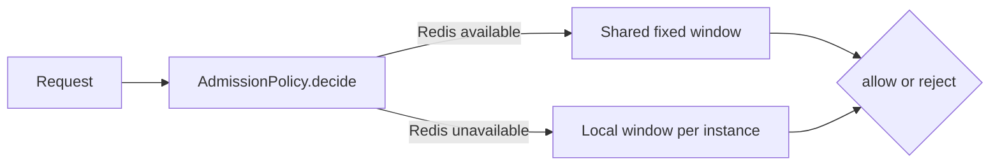

# Shared admission policy

<PlanWorkspace>
```json
{
  "decisions": [
    {
      "id": "admission",
      "title": "Give the gateway one admission policy",
      "reasoning": {
        "benefits": [
          {
            "title": "The gateway chooses the quota, rejection response and outage behavior for every service."
          }
        ],
        "costs": [
          {
            "id": "availability",
            "title": "Serving requests while enforcing per subject limits during Redis outages requires a local counter.",
            "detail": "The fallback counts requests seen by this gateway instance, including requests admitted while Redis was healthy. Limits are per instance during an outage. State resets at a fixed window boundary and on restart; recovery returns to the shared counter without merging local history. Failures can therefore admit more requests than the shared quota. A full local subject map rejects new subjects during an outage. Allowing all outage requests would remove the local counter and its capacity policy."
          }
        ]
      },
      "code": [
        {
          "id": "policy-model",
          "role": "model",
          "file": "src/gateway/admission.ts",
          "symbol": "AdmissionPolicy",
          "language": "typescript",
          "summary": "Illustrative design sketch, not inspected repository code. The policy and local counter below expose the proposed mechanism. The existing authentication, clock, HTTP response and atomic Redis adapter are infrastructure boundaries, identified at their use sites. Replace current snippets with inspected code in a real plan.",
          "current": "interface Limiter {\n  allow(token: string): Promise<boolean>\n}\n// Each service chooses its rejection response and outage behavior.",
          "proposed": "type TokenHash = string // Existing authenticated identity, never a raw token.\ntype Admission =\n  | { kind: 'allow' }\n  | { kind: 'reject'; retryAfterSeconds: number }\n\ntype SharedAttempt =\n  | { kind: 'counted'; attempts: number }\n  | { kind: 'unavailable' }\n\n// Existing Redis adapter boundary, not implemented by this proposal.\n// Atomically increment a subject's fixed window key and expire it after\n// the window. attempts includes this request, including rejected attempts.\n// Only availability failures return unavailable; other errors propagate.\ninterface SharedCounter {\n  consume(subject: TokenHash, windowStart: number, windowMs: number): Promise<SharedAttempt>\n}\n\ninterface AdmissionPolicy {\n  decide(subject: TokenHash, now: number): Promise<Admission>\n}\n\n// One policy and local counter live for the gateway process lifetime.\n// One fixed 60 second window allows 60 attempts per subject.\n// The local map retains at most 10,000 subjects in the current window.\nconst policy = new GatewayAdmissionPolicy(sharedCounter, 60, 60_000, 10_000)"
        },
        {
          "id": "admission-operation",
          "file": "src/gateway/admission.ts",
          "symbol": "GatewayAdmissionPolicy.decide",
          "language": "typescript",
          "change": "add",
          "proposed": "export class GatewayAdmissionPolicy implements AdmissionPolicy {\n  private readonly local: LocalWindowCounter\n\n  constructor(\n    private readonly shared: SharedCounter,\n    private readonly limit: number,\n    private readonly windowMs: number,\n    maxLocalSubjects: number,\n  ) {\n    // Trusted startup configuration: positive integers, validated at startup.\n    this.local = new LocalWindowCounter(maxLocalSubjects, limit)\n  }\n\n  async decide(subject: TokenHash, now: number): Promise<Admission> {\n    // Existing clock supplies nondecreasing epoch milliseconds.\n    const windowStart = Math.floor(now / this.windowMs) * this.windowMs\n    const retryAfterSeconds = Math.max(\n      1, Math.ceil((windowStart + this.windowMs - now) / 1000),\n    )\n\n    // Count synchronously before awaiting Redis, including healthy traffic.\n    // Every concurrent request receives its own local attempt count.\n    const local = this.local.consume(subject, windowStart)\n    const shared = await this.shared.consume(subject, windowStart, this.windowMs)\n    const attempt = shared.kind === 'counted' ? shared : local\n\n    // During an outage, reject a new subject if local tracking is full.\n    if (attempt.kind === 'capacity' || attempt.attempts > this.limit) {\n      return { kind: 'reject', retryAfterSeconds }\n    }\n    return { kind: 'allow' }\n  }\n}",
          "invariants": [
            "The selected counter includes the current request before admission is decided.",
            "A shared counter result is authoritative whenever Redis responds.",
            "An unavailable shared counter selects the local count or rejects on local capacity."
          ],
          "summary": "Illustrative proposed operation. The Redis adapter must satisfy the explicit atomic counter contract. The fallback supplies an independent instance quota, so it cannot preserve a global quota through outages or restarts."
        },
        {
          "id": "local-window-counter",
          "file": "src/gateway/admission.ts",
          "symbol": "LocalWindowCounter",
          "language": "typescript",
          "change": "add",
          "proposed": "type LocalAttempt =\n  | { kind: 'counted'; attempts: number }\n  | { kind: 'capacity' }\n\nclass LocalWindowCounter {\n  private windowStart: number | undefined\n  private readonly attempts = new Map<TokenHash, number>()\n\n  constructor(\n    private readonly maxSubjects: number,\n    private readonly limit: number,\n  ) {}\n\n  consume(subject: TokenHash, windowStart: number): LocalAttempt {\n    if (this.windowStart !== windowStart) {\n      this.attempts.clear()\n      this.windowStart = windowStart\n    }\n    const previous = this.attempts.get(subject)\n    if (previous === undefined && this.attempts.size >= this.maxSubjects) {\n      return { kind: 'capacity' }\n    }\n    // Saturation avoids growing counts after the rejection threshold.\n    const attempts = Math.min((previous ?? 0) + 1, this.limit + 1)\n    this.attempts.set(subject, attempts)\n    return { kind: 'counted', attempts }\n  }\n}",
          "invariants": [
            "A window retains at most maxSubjects entries. Existing subjects retain their counts when capacity is reached.",
            "Advancing to the next fixed window clears the map. Destroying the gateway process releases it."
          ]
        },
        {
          "id": "gateway-dispatch",
          "file": "src/gateway/middleware.ts",
          "symbol": "gatewayMiddleware",
          "language": "typescript",
          "current": "return dispatch(request) // Services check their own limits.",
          "proposed": "// One process scoped policy instance is injected into the gateway.\nconst result = await policy.decide(request.auth.tokenHash, clock.now())\nif (result.kind === 'reject') {\n  return tooManyRequests(result.retryAfterSeconds)\n}\nreturn dispatch(request)",
          "invariants": [
            "Rejected requests never dispatch."
          ],
          "summary": "Illustrative gateway wiring. Authentication, clock, dispatch and response construction are established infrastructure. tooManyRequests returns HTTP 429 with Retry-After in seconds. Shared counter errors other than unavailability propagate to the existing HTTP error boundary."
        },
        {
          "id": "remove-search-gate",
          "file": "src/search/rate-gate.ts",
          "symbol": "SearchRateGate",
          "language": "typescript",
          "change": "delete",
          "current": "export class SearchRateGate {\n  constructor(private readonly limiter: Limiter) {}\n\n  async check(token: string) {\n    if (!await this.limiter.allow(token)) throw new RateLimitError()\n  }\n}"
        }
      ],
      "examples": [
        {
          "id": "at-limit",
          "title": "A request at the limit receives retry metadata",
          "description": "The shared subject count is already 60 in the fixed window beginning at epoch zero. The adapter result below is an explicit example fixture.",
          "language": "typescript",
          "code": "const shared: SharedCounter = {\n  async consume() { return { kind: 'counted', attempts: 61 } },\n}\nconst policy = new GatewayAdmissionPolicy(shared, 60, 60_000, 10_000)\nawait policy.decide('subject:a', 30_000)",
          "result": {
            "label": "Admission",
            "language": "json",
            "value": "{ \"kind\": \"reject\", \"retryAfterSeconds\": 30 }"
          }
        },
        {
          "id": "counter-outage",
          "title": "Redis becomes unavailable",
          "language": "typescript",
          "code": "const unavailable: SharedCounter = {\n  async consume() { return { kind: 'unavailable' } },\n}\nconst policy = new GatewayAdmissionPolicy(unavailable, 60, 60_000, 10_000)\nfor (let request = 0; request < 60; request++) {\n  await policy.decide('subject:a', 30_000) // allow\n}\nawait policy.decide('subject:a', 30_000) // reject, retryAfterSeconds: 30\nawait policy.decide('subject:a', 60_000) // allow, new fixed window",
          "outcome": "Another gateway instance has its own allowance. Recovery uses the shared count, which excludes outage traffic; no local history is merged.",
          "description": "One gateway instance stays in the same window while Redis is unavailable. The adapter fixture exposes the availability result without claiming a global quota.",
          "result": {
            "label": "Final admission",
            "language": "json",
            "value": "{ \"kind\": \"allow\" }"
          }
        },
        {
          "id": "local-capacity",
          "title": "A new subject reaches a full fallback map",
          "description": "A capacity of one makes the boundary visible. Existing subjects keep their counts; a new window releases capacity.",
          "language": "typescript",
          "code": "const unavailable: SharedCounter = {\n  async consume() { return { kind: 'unavailable' } },\n}\nconst policy = new GatewayAdmissionPolicy(unavailable, 60, 60_000, 1)\nawait policy.decide('subject:a', 30_000) // allow, reserves the only slot\nawait policy.decide('subject:b', 30_000) // reject, retryAfterSeconds: 30\nawait policy.decide('subject:a', 30_000) // allow, second attempt\nawait policy.decide('subject:b', 60_000) // allow, new window clears slots",
          "outcome": "The local map stays bounded. An available Redis result still decides admission when the local map is full."
        }
      ],
      "ownership": [
        {
          "id": "catalog",
          "area": "Catalog requests",
          "current": "CatalogRateGate",
          "proposed": "Gateway.AdmissionPolicy",
          "removed": [
            "CatalogRateGate"
          ]
        },
        {
          "id": "search",
          "area": "Search requests",
          "current": "SearchRateGate",
          "proposed": "Gateway.AdmissionPolicy",
          "removed": [
            "SearchRateGate"
          ]
        }
      ]
    }
  ]
}
```

<Visual decision="admission" id="admission-path" title="Which counter decides a request">



</Visual>
</PlanWorkspace>
