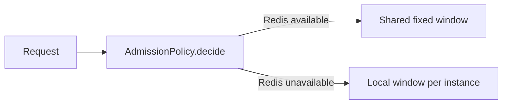

# PlanWorkspace

Use a workspace to review concrete software models. Read actual source and use the required subagent design challenge before authoring. The local planning skill owns investigation and publication when active; this reference defines the renderer model.

Author one canonical JSON block inside `<PlanWorkspace>`. Read `packages/cli/templates/workspace-example.mdx` for a complete authoring example with connected contracts, implementation, callers, and behavior examples. Validate with the project's pinned helper or `vplan check`.

The reader sees each decision in this order: current and proposed model code, material rationale and tradeoffs, independent useful examples of usage, behavior, or lifecycle, then the decisive change set. Diagrams are supplemental. End the artifact at the changes. Do not add implementation routes, evidence appendices, research diaries, or correction histories.

## Decisions and models

A decision requires stable `id`, meaningful `title`, and reviewable `code`. Split large plans into coherent design choices, ordered by dependency. Multiple decisions have a navigator showing one decision's model, examples, and changes at a time, with independent review state. Optional `goal` adds context only when necessary. A code item with `role: "model"` appears first and is excluded from the final change set, so it is displayed once. This fragment demonstrates model syntax only; a complete decision also shows the implementation that establishes and uses its saved baseline:

```json
{
  "id": "baseline",
  "title": "Capture expectations from the saved baseline",
  "code": [
    {
      "id": "baseline-model",
      "role": "model",
      "file": "panel/lib/authoring/edit.dart",
      "symbol": "expectation capture",
      "language": "dart",
      "summary": "Illustrative condensed comparison. Adapt only after inspecting real source.",
      "current": "observed[key] = operation.expectation;",
      "proposed": "observed.putIfAbsent(key, () => savedBaseline.observe(key));"
    }
  ]
}
```

Every decision needs a model entry containing `current` and `proposed`, rather than `diff`. Identify context through `file`, `symbol`, and a real syntax `language`. Connect relevant contracts, owned state, and operations across as many entries as the design requires. Ground the current model in inspected source; identify condensed comparisons and sketches in optional `summary` when needed. Do not pretend illustrative code is an exact repository excerpt.

Optional `reasoning` contains `benefits` and `costs` arrays. A card requires `title`; optional `detail` adds information. Optional card `id` gives stable identity across title changes. Omit text that merely repeats the code or heading. Explain an expensive tradeoff where it affects the design. Do not fill generic alternative, assumption, risk, and consequence inventories.

Optional decision `ownership` rows show how several areas change owners or converge on a shared implementation. Each has stable `id`, `area`, `current`, `proposed`, and optional `removed` symbol or path names. The table appears beside the code model, with feedback targets for rows and cells. Use it to replace repeated ownership prose; omit it when code already makes the relationship clear.

## Examples and edits

Examples require `id`, `title`, `language`, and `code`. Optional `description` gives necessary usage context; optional `outcome` explains nonobvious behavior. Optional `result` contains `label`, `value`, and `language` (default `json`). Examples illustrate independent usage, observable behavior, or lifecycle from the relevant developer or product user perspective. They need no execution sequence, file, symbol, or linked input and output. Do not force an arbitrary execution trace or internal API into an example; a behavior example may use a text snippet. Choose distinct meaningful situations and omit examples that teach nothing new. Mark pseudocode where necessary. Legacy `flows` fail validation.

Code entries with default `role: "edit"` form the final change set. They require `id`, `file`, and `symbol`; use optional `summary`, `invariants`, and `callers` only when they help assessment. `change` is `modify`, `add`, `delete`, or `move`. Use `diff` for an exact unified diff, otherwise `proposed` and optional `current`. Include the operation bodies, helper implementations, integration, and consequential deletions needed to complete the mechanism introduced by the model. A signature or usage example cannot stand in for an unexplained implementation. Include this coverage in the first draft. Show each snippet once and omit incidental boilerplate, keeping complete relevant functions when that makes the behavior easier to assess. A material verification condition belongs beside the decision or edit it proves.

## Custom visuals

Some parts of a decision read better as a diagram, table, comparison, chart, or mockup than as code. Place `<Visual>` elements after the json block inside `<PlanWorkspace>`. `decision` names the decision id, `id` is stable within it, and `title` heads the visual. The body is ordinary MDX: a mermaid fence, `Matrix`, `Compare`, `Chart`, `Svg`, a table, or short prose. Visuals render under the decision title, before the code model, and take comments like any other target. Their MDX source is part of the decision review, so changing a visual asks for a new decision review. A visual supplements the code model; it does not replace it.

````mdx
<Visual decision="admission" id="admission-path" title="Which counter decides a request">



</Visual>
````

A pure removal uses `change: "delete"`, inspected `current` code, and no `proposed`. Its review controls stay visible while the code is available on expansion. Complete file deletion diffs using `+++ /dev/null` also collapse. Mixed edits remain expanded. Do not invent replacement code to represent absence.

## Reviews and revisions

Keep stable decision, example, and code IDs for unchanged concepts. Do not recycle them. Meaningful titles and anchors make comments understandable without copying the plan. Source metadata is supplied by the renderer, rather than authored into JSON.

The runtime owns review marks, comments, drafts, and export. Do not author custom controls, persistence, or approval bookkeeping. Authored status is not approval. Nested denials prevent decision acceptance; decision actions mark only unreviewed child code, preserving existing marks. Undo clears the decision mark. Existing comparison code has no separate mark, but forms part of the proposal snapshot.

Changes since the revision the reader last opened are highlighted in place: tinted text with a word diff on hover, tinted code lines that show the replaced lines on hover, and a per decision list of removed items. Stable IDs are what make this precise; a recycled or renamed ID reads as a removal plus an addition. Changed reviewed content shows `Changed` with its previous version available for comparison. Automatically accepted decisions also retain a baseline. Changes to decision meaning or contents require another decision review while unchanged code approvals remain; accepting the last open block inside a changed decision counts as that review. Each example has one review mark covering its usage and result.

At the same artifact path, unchanged targets retain comments, drafts, and marks. Changed or deleted targets retire saved comments. Unsaved drafts remain visible with a stale target warning and saving disabled so the user can recover their writing. Changed content invalidates the affected mark. Comments have no type; the body says whether it asks, objects, or requests a change. Export contains concise saved comments with target path, selected text or a short excerpt, source, and revision; it excludes plan inventories, selection offsets, and reviewed snapshots. Copying the packet marks its comments as sent, and sent comments retire when the next revision loads. Resolve stale packets against retained source. Marks and comments are local to the browser, not embedded in HTML or synchronized between browsers.

The change queue keeps pending proposals accessible and retains reviewed proposals. Accepting or denying advances to the next pending change. Extend components or their model when a concrete explanation needs a better representation. Preserve decision navigation, feedback targeting, semantic colors, syntax highlighting, and the shared review system. Remove automatic text that does not help understanding or review. A browser acceptance mark is not permission to implement.
